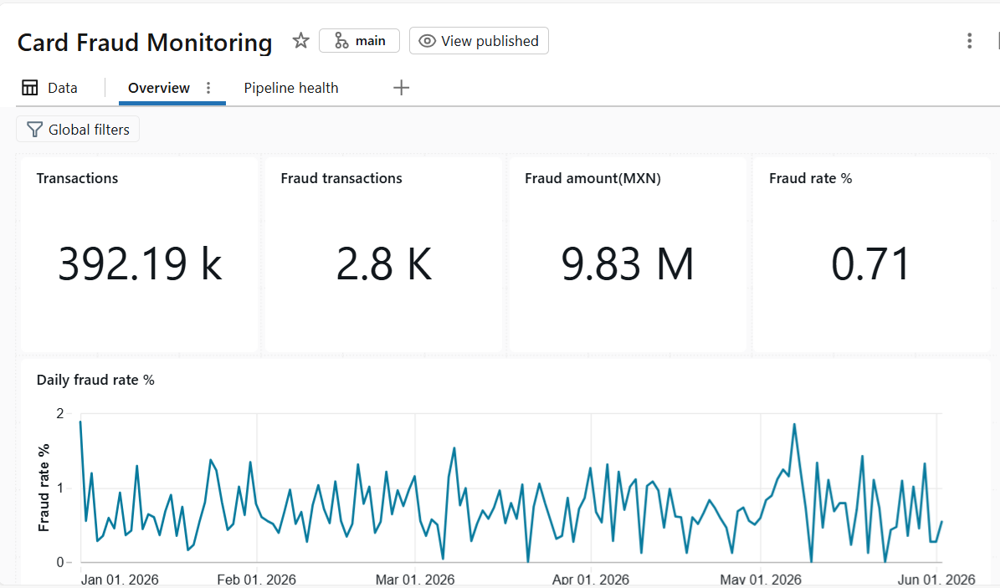
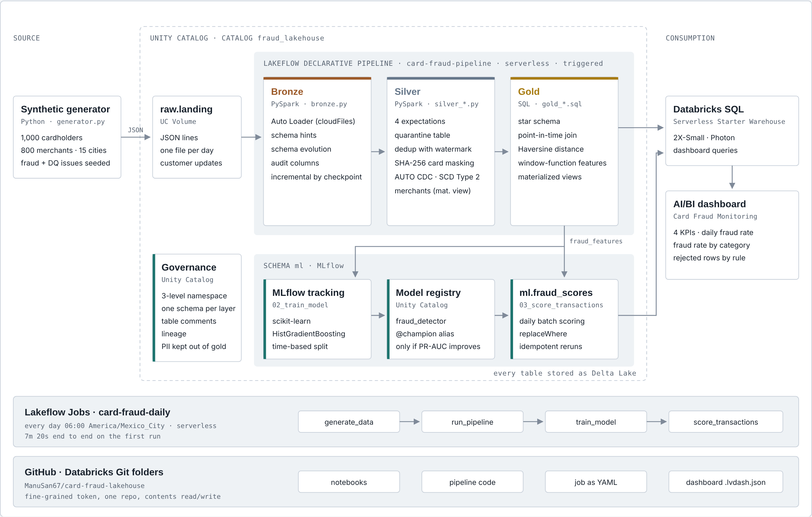
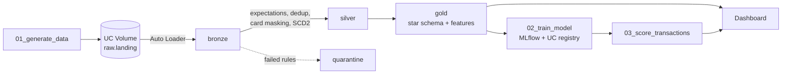

# Card Fraud Lakehouse on Databricks

[](https://github.com/ManuSan67/card-fraud-lakehouse/actions/workflows/ci.yml)

End-to-end lakehouse for card fraud detection, built on Databricks Free Edition with synthetic data:
incremental ingestion, a declarative pipeline with data quality rules, a star schema, a fraud model
tracked in MLflow, a daily job, governance with Unity Catalog, monitoring and alerts, and CI/CD with
Declarative Automation Bundles and GitHub Actions.



## Architecture





A Lakeflow Job runs `generate_data → run_pipeline → train_model → score_transactions` every day at 6:00 (Mexico City).

## What it covers

| Area | Implementation |
|---|---|
| Ingestion | Auto Loader with schema hints, schema evolution (`device_type` appears on day 120) and audit columns |
| Data quality | Four expectations on transactions; failed rows go to a quarantine table with the rules they broke |
| Deduplication | Streaming dedup with watermark (`dropDuplicatesWithinWatermark`) |
| PII | Card number replaced by SHA-256 hash and last 4 digits in silver; no names or card numbers in gold |
| History | Customers as SCD Type 2 with `AUTO CDC` |
| Modeling | Star schema with a point-in-time join to the customer version valid at transaction time |
| Features | SQL window functions: velocity (1h), amount vs. 30-day average, distance from home (Haversine), time of day, category risk. Only past data is used |
| ML | Gradient boosting tracked in MLflow, registered in Unity Catalog; the `champion` alias moves only when PR-AUC improves |
| Scoring | Daily batch scoring with the champion model, idempotent through `replaceWhere` |
| Governance | Two groups with least-privilege grants; a secure view with a row filter and column masks by group; PII tags on columns |
| Delta Lake operations | Recovery of an accidental delete with `DESCRIBE HISTORY`, time travel and `RESTORE`; deep clone, Change Data Feed, `OPTIMIZE`, `VACUUM` and liquid clustering |
| Monitoring | Expectation metrics from the pipeline event log, three SQL alerts (data quality, fraud rate, freshness) and job notifications on failure and on runs longer than 15 minutes |
| CI/CD | Pipeline and job defined as a bundle with `dev` and `prod` targets; GitHub Actions tests every pull request and deploys `prod` on merge to `main` |

## Data quality reconciliation

Every run reconciles: bronze = silver + quarantine + removed duplicates.

| Layer | Rows (first 151 days) |
|---|---|
| Bronze | 392,317 |
| Silver (valid, deduplicated) | 386,926 |
| Quarantine | 3,542 |
| Duplicates removed | 1,849 |

## Model results

Time-based split: trained on the oldest 80% of days, tested on the most recent 20%.

| Metric | Model | Rules baseline |
|---|---|---|
| PR-AUC | 0.97 | – |
| Recall | 0.99 | 0.89 |
| Precision | 0.47 | 0.11 |

The model catches almost all fraud with about four times the precision of a simple rules engine
(amount above 3x the 30-day average or 3+ transactions in one hour).

**Caveat:** the data is synthetic and the fraud patterns were planted by the generator, so the model
is expected to score very high. The goal of the project is the data engineering and the MLOps flow,
not a production fraud model.

## Governance

| Group | Can read | Sees in `v_customer_secure` |
|---|---|---|
| `fraud_analysts` | Fact table, merchant, date and category dimensions, `v_customer_secure` | Only customers in Jalisco; card last 4 and credit limit masked |
| `risk_team` | Same tables | All customers, with card last 4 and credit limit |

`dim_customer` is a materialized view managed by the pipeline, so row filters and column masks are
applied through the secure view `gold.v_customer_secure` with `is_account_group_member()`.
PII tags on `card_last4`, `credit_limit`, `home_lat` and `home_lon` persist across pipeline runs.

## Monitoring and alerts

| Alert | Condition |
|---|---|
| Data quality | Any expectation fails more than 2% of rows in the last day (`gold.pipeline_quality_log`) |
| Fraud rate | More than 1.5% of the latest day's transactions flagged |
| Freshness | More than 26 hours since the last bronze load |

The job emails on failure and when a run takes longer than 15 minutes. The dashboard has a
Pipeline health page built on `gold.pipeline_quality_log`.

## CI/CD and environments

| Target | Catalog | How it is deployed |
|---|---|---|
| `dev` | `fraud_lakehouse_dev` | `databricks bundle deploy` from a developer machine; names prefixed with `[dev user]`, schedule paused |
| `prod` | `fraud_lakehouse` | Only by GitHub Actions on merge to `main`; the job is locked for editing in the UI |

The catalog is a parameter: the pipeline reads it from its configuration and the notebooks from a job
parameter, so the same code runs in both targets.

1. Work on a branch and test it in `dev`.
2. Open a pull request: GitHub Actions runs `pytest` and `databricks bundle validate -t prod`.
3. Merge to `main`: the same workflow runs the tests again and `databricks bundle deploy -t prod`.

The existing production pipeline and job were attached to the bundle with `databricks bundle deployment bind`,
so the first deploy updated them in place (0 created, 2 changed, 0 deleted) and kept their tables.
The prod deploy runs without `--auto-approve`: a change that would recreate the pipeline, and drop its
tables, fails instead of running silently.

GitHub authenticates with a Databricks personal access token limited to the jobs, pipelines, workspace,
files and scim scopes, stored as repository secrets. In a company workspace this would be a service
principal with OAuth, which Free Edition does not support.

## Created outside the repository

These objects were created in the Databricks UI and are not deployed by the bundle:

- Groups `fraud_analysts` and `risk_team`
- The three SQL alerts
- The `fraud_lakehouse_dev` catalog with the same schemas and Volume as `fraud_lakehouse`
- GitHub secrets `DATABRICKS_HOST` and `DATABRICKS_TOKEN`

## Repository layout

```
databricks.yml             bundle: catalog variable, dev and prod targets
resources/
  card_fraud_pipeline.pipeline.yml
  card_fraud_daily.job.yml
notebooks/
  00_Setup                 catalog, schemas and Volume
  01_generate_data         writes the next day of data (150 days on the first run)
  02_train_model           training, MLflow tracking and champion promotion
  03_score_transactions    daily batch scoring
  04_governance            grants, row filter and column masks, PII tags
  05_delta_operations      history, time travel, restore, clone, CDF, optimize, vacuum
  06_monitoring            event log queries and pipeline_quality_log view
src/
  generator.py             synthetic data generator (Python standard library only)
  pipeline/transformations/
    bronze.py              Auto Loader ingestion
    silver_transactions.py expectations, quarantine, dedup, card masking
    silver_customers.py    SCD Type 2 customers and merchants
    gold_star_schema.sql   dimensions and fact table
    gold_features.sql      model features
tests/
  test_generator.py        generator unit tests
.github/workflows/
  ci.yml                   tests and validation on pull requests, prod deploy on main
dashboards/
  Card Fraud Monitoring.lvdash.json
```

## How to run it

1. Create a Databricks Free Edition account and add this repo as a Git folder.
2. Run `notebooks/00_Setup` once, and create `fraud_lakehouse_dev` with the same schemas and Volume.
3. Install the Databricks CLI and log in with `databricks auth login --host <workspace-url>`.
4. Deploy and run the dev target:
   ```
   databricks bundle deploy
   databricks bundle run card_fraud_daily
   ```
   The first run writes 150 days of data.
5. For production, add the `DATABRICKS_HOST` and `DATABRICKS_TOKEN` secrets to the GitHub repository; merging to `main` deploys the `prod` target.

Run the tests locally with `pip install pytest` and `pytest`.

## Tech stack

Databricks (Unity Catalog, Auto Loader, Lakeflow Declarative Pipelines, Lakeflow Jobs, Databricks SQL
and alerts, AI/BI dashboards, Declarative Automation Bundles, Databricks CLI), Delta Lake, PySpark, SQL,
MLflow, scikit-learn, GitHub Actions, pytest.
