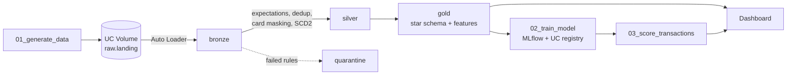

# Card Fraud Lakehouse on Databricks

End-to-end lakehouse for card fraud detection, built on Databricks Free Edition with synthetic data:
incremental ingestion, a declarative pipeline with data quality rules, a star schema, a fraud model
tracked in MLflow, a daily job and a monitoring dashboard.


## Architecture



A Lakeflow Job runs `generate_data → run_pipeline → train_model → score_transactions` every day at 6:00 (Mexico City).

## What it covers

| Area | Implementation |
|---|---|
| Ingestion | Auto Loader with schema hints, schema evolution (`device_type` appears on day 120) and audit columns |
| Data quality | Four expectations on transactions; failed rows go to a quarantine table with the rules they broke |
| Deduplication | Streaming dedup with watermark (`dropDuplicatesWithinWatermark`) |
| PII | Card number replaced by SHA-256 hash and last 4 digits in silver; no names or card numbers in gold |
| History | Customers as SCD Type 2 with `AUTO CDC` |
| Modeling | Star schema with a point-in-time join to the customer version valid at transaction time |
| Features | SQL window functions: velocity (1h), amount vs. 30-day average, distance from home (Haversine), time of day, category risk. Only past data is used |
| ML | Gradient boosting tracked in MLflow, registered in Unity Catalog; the `champion` alias moves only when PR-AUC improves |
| Scoring | Daily batch scoring with the champion model, idempotent through `replaceWhere` |
| Governance | Unity Catalog catalog with one schema per layer, governed Volume, table comments and lineage |

## Data quality reconciliation

Every run reconciles: bronze = silver + quarantine + removed duplicates.

| Layer | Rows (first 151 days) |
|---|---|
| Bronze | 392,317 |
| Silver (valid, deduplicated) | 386,926 |
| Quarantine | 3,542 |
| Duplicates removed | 1,849 |

## Model results

Time-based split: trained on the oldest 80% of days, tested on the most recent 20%.

| Metric | Model | Rules baseline |
|---|---|---|
| PR-AUC | 0.97 | – |
| Recall | 0.99 | 0.89 |
| Precision | 0.47 | 0.11 |

The model catches almost all fraud with about four times the precision of a simple rules engine
(amount above 3x the 30-day average or 3+ transactions in one hour).

**Caveat:** the data is synthetic and the fraud patterns were planted by the generator, so the model
is expected to score very high. The goal of the project is the data engineering and the MLOps flow,
not a production fraud model.

## Repository layout

```
notebooks/
  00_Setup                 catalog, schemas and Volume
  01_generate_data         writes the next day of data (150 days on the first run)
  02_train_model           training, MLflow tracking and champion promotion
  03_score_transactions    daily batch scoring
src/
  generator.py             synthetic data generator (Python standard library only)
  pipeline/transformations/
    bronze.py              Auto Loader ingestion
    silver_transactions.py expectations, quarantine, dedup, card masking
    silver_customers.py    SCD Type 2 customers and merchants
    gold_star_schema.sql   dimensions and fact table
    gold_features.sql      model features
resources/
  card_fraud_daily.job.yml job definition
dashboards/
  Card Fraud Monitoring.lvdash.json
```

## How to run it

1. Create a Databricks Free Edition account and add this repo as a Git folder.
2. Run `notebooks/00_Setup` once.
3. Run `notebooks/01_generate_data` to write the first 150 days.
4. Create an ETL pipeline with catalog `fraud_lakehouse`, default schema `bronze`, and source code `src/pipeline`.
5. Create the job from `resources/card_fraud_daily.job.yml`, updating the notebook paths and `pipeline_id` for your workspace.

## Tech stack

Databricks (Unity Catalog, Auto Loader, Lakeflow Declarative Pipelines / DLT, Lakeflow Jobs / Workflows,
Databricks SQL, AI/BI dashboards), Delta Lake, PySpark, SQL, MLflow, scikit-learn.